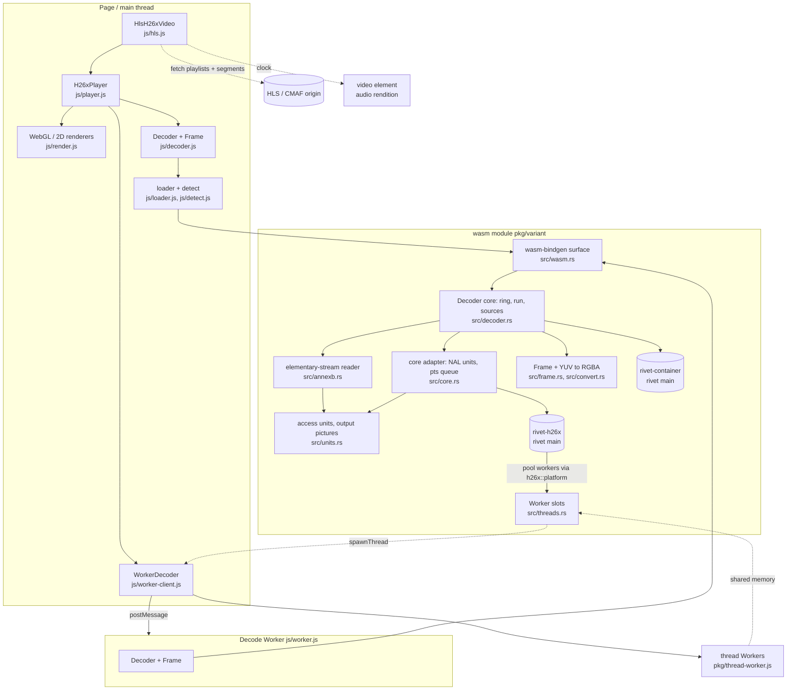

# wasm-h26x: feature docs

> **Last verified against code:** 2026-11-15 @ `bb70073`

wasm-h26x is H.264 and H.265 decoding for browsers that cannot decode
them themselves (H.265 in Firefox and on machines without hardware HEVC,
H.264 in builds without the licensed decoder). It is wasm-av1 with
rivet-h26x in place of rivet-av1: rivet's own H.264 and H.265 decoders
(crate `rivet-h26x`, imported as `h26x`, written from the ITU-T
Recommendations) compiled to WebAssembly in four variants, with containers
demuxed inside the same wasm by rivet's `rivet-container`, behind wasm-av1's
pull-style API (itself ported from GoogleChromeLabs/wasm-av1). On top of the
wasm sits wasm-av1's ESM JavaScript layer, renamed: loader and feature
detection, a `Decoder` wrapper, a decode Worker, WebGL and 2D renderers,
`H26xPlayer` and `HlsH26xVideo`. It is a library, not a service: nothing
deploys. A `v*` tag builds and publishes `@safewords/wasm-h26x` to npm and
to a GitHub Release; as of `bb70073` (0.1.0) there is no tag and no
consumer. `pkg/` holds CI's build of `4c72771`, committed by hand
(`3b0ab49`). Pushing `main` only runs CI.

What is new against wasm-av1 is in the Rust: `src/units.rs` finds
access-unit boundaries and decides which pictures are output, so that each
frame can be given the right pts although frames leave in output order;
`src/annexb.rs` reads elementary streams where wasm-av1 read IVF; and
`src/threads.rs` runs rivet-h26x's per-decoder worker pools on Workers it
keeps. On 2026-11-15 every fixture decoded frame by frame equal to
rivet-h26x's own native decoder (`h26xdec`): natively on 1, 2 and 4
threads, and in all four wasm variants (the threads builds on 1, 2, 4 and
8 threads), and 33 player combinations played
in each of Chromium, Firefox and WebKit (again at `42acb04`, with
rivet-h26x from rivet `main` `f5d350e`). Speed, measured on 2026-11-15
in Chromium, WebKit and Firefox on CI's build: see
[`../performance.md`](../performance.md).

## Index

| Component | Status | Doc |
|---|---|---|
| Decoder core (ring, `run`, `finished`, flush, pts) | PARTIAL (a picture that is never output shifts every later pts) | [decoder-core.md](./decoder-core.md) |
| Input sources (elementary streams, containers via rivet, push, CMAF segments, rendition switch) | PARTIAL (an H.265 switch onto an open GOP loses its leading pictures; no switch between codecs) | [input-sources.md](./input-sources.md) |
| Frames, colour conversion and rendering | STABLE | [frames-and-rendering.md](./frames-and-rendering.md) |
| wasm variants, detection and threading | PARTIAL (a thread Worker that never starts hangs the decoder; WebKit runs out of memory after many threads-build instances in one page) | [variants-and-threading.md](./variants-and-threading.md) |
| JS decoder API and the decode Worker | PARTIAL (stale frames after flush; `load` can hang) | [js-api-and-worker.md](./js-api-and-worker.md) |
| H26xPlayer and HlsH26xVideo | PARTIAL (no H.265 ladder has been played) | [player-and-hls.md](./player-and-hls.md) |
| Build, tests and release | PARTIAL (the committed `pkg/` is replaced from CI's build by hand, so it can trail `main` by a commit; nothing released) | [build-and-release.md](./build-and-release.md) |

Deeper material that stays authoritative for its subject:
[`../performance.md`](../performance.md) (speed in Chromium, WebKit and
Firefox, and against a native decoder for context),
[`../rivet-h26x.md`](../rivet-h26x.md) (the decoder),
[`../rivet.md`](../rivet.md) (the demuxer),
[`../integration.md`](../integration.md) (how a player should adopt the
fallback). wasm-av1's own feature docs hold the history of everything
taken from it unchanged: the spawn relay, the WebKit copy guard, the
Worker protocol, the HLS layer.

## Known defects

| Component | Defect | Severity |
|---|---|---|
| Decoder core | **pts are assigned by assumption.** Each frame takes the smallest pending pts, which is right only if every pts that goes in gets exactly one frame (`src/core.rs:186-189`, `196-220`). A picture rivet-h26x refuses or does not output (an H.265 `pic_output_flag` of 0, `no_output_of_prior_pics_flag`, a RASL picture the tracker and the decoder disagree about) leaves its pts behind, and every later frame is shown one frame's time early until the source ends or a flush. Nothing detects it. Field pairing and RASL skipping have no fixture. | Medium |
| Input sources | **An H.265 rendition switch onto an open-GOP segment loses that segment's leading pictures.** The end of sequence put in front of it (`src/decoder.rs:420-423`) makes the decoder skip the CRA's RASL pictures, so the canvas holds a frame for their duration; the same after a seek or a hard switch. x265 makes open GOPs by default. Untested: `testdata/cmaf-hevc` (open GOP, CRA and RASL at the segment boundary) proves only the continuous decode, where the RASL pictures are decoded, not a switch onto such a segment. | Medium |
| JS API & Worker | `WorkerDecoder.flush()` / `setSource()` clear the page-side queue, but frames the Worker posted before it saw the message still arrive and are queued: a few frames of the old position or file are shown after a seek or reload. Messages carry no generation (`js/worker-client.js:138-144`, `205-209`). | Medium |
| JS API & Worker | `H26xPlayer.load()` in Worker mode polls `src.info` (`js/player.js:126`, `133-138`); if the Worker rejects the source `info` never arrives and `load()` never settles. | Medium |
| Variants & threading | **A thread Worker that never starts, or traps, hangs the decoder and every reset of it.** rivet-h26x's pool waits, when dropped, for each worker body it asked for to return (rivet-h26x `src/threading.rs:336-356`), so after a failed Worker (`js/thread-worker.js:19-25`, `src/threads.rs:159-166`) a flush, a new source or `free` blocks the decode Worker for good. Only the console says so. | Medium |
| Variants & threading | **WebKit runs out of memory after many threads-build instances in one page.** Each instance has its own shared memory declared with a 1 GiB maximum (`scripts/build.sh:62`). In one WebKit page, after about 36 such instances had been created and their Workers terminated, `new WebAssembly.Memory` failed with out of memory for every later one, and single-threaded instances in the same page ran at about two thirds of their rate; a fresh page was fine ([`../performance.md`](../performance.md)). Reuse one decoder (`flush()` / `setSource()`) rather than make one per video. | Medium |
| Variants & threading | `test/browser.mjs` is not in CI (Playwright is not installed there). It was last run on 2026-11-15 at `69fe490` (v0.1.0), against CI's build of `4c72771` in `pkg/` (`3b0ab49`): 33/33 combinations in each of Chromium, Firefox and WebKit (Playwright 1.62.1). A regression in a browser shows up only when somebody runs it. | Medium |
| Input sources | **A switch to the other codec is not handled.** A segment of the other codec resets the core (`src/decoder.rs:402-406`): frames decoded and not in the ring are lost, and the old codec's units still queued go to the new codec's decoder. `variantForBandwidth` does not keep to one codec (`js/hls.js:257-266`). | Low |
| Frames & rendering | **WebGL draws frames above 8 bits through RGBA.** They are converted in wasm on the CPU every frame and reach the GPU as 8-bit (`js/render.js:165-171`); in a Worker both the planes and the RGBA are copied and posted (`js/worker.js:69-72`). | Low |
| Decoder core | **`units_in_flight` is an upper bound with threads.** It counts every pending pts (`src/core.rs:260-266`), including pictures that only more input or the end can release, and pts that lost their picture. The decode Worker re-polls every 4 ms while it is not 0 (`js/worker.js:82-87`): on a live stream waiting for input, until input comes; after a lost picture, until the source ends. | Low |
| Decoder core | **Output lags input**, with one thread too: a picture leaves only after the next one begins and when the reorder buffer lets it, and with threads a few units later still. A caller that stops calling `run()` at `STARVED` loses the frames in flight until it feeds more or ends the stream. | Low |
| Build & release | The committed `pkg/` is replaced only from CI's build, by hand, after the source commit that changes it (`3b0ab49` holds CI's build of `4c72771`). Between the two a `github:safewords/wasm-h26x#main` consumer gets the previous wasm with the new JS. CI's "does the committed `pkg/` match" step is a warning only (`ci.yml:101-103`). | Low |
| Build & release | `scripts/build.sh` does not run on a stock macOS (checked 2026-11-15): GNU-only sed expressions (`:48`, `:50`), empty arrays under `set -u` on bash 3.2 (`:75`), GNU `stat -c %s` (`:144`). | Low |
| Player & HLS | `_switchAtBoundary` locates the decoding segment by comparing cumulative pushed samples with `stats.decoder.accessUnitsIn`, which is never reset by a flush and counts past the 64-entry `_pushed` window (`js/hls.js:343-349`, `449`). After a seek or 64 segments, a boundary switch lands after everything already pushed: correct, but up to `prefetchSeconds` late. | Low |

Checked from wasm-av1's table and **not** carried over:

- *A truncated IVF frame loops.* There is no IVF reader. An elementary
  stream is cut into access units up front (`src/annexb.rs:74-125`); a
  stream cut short ends in a shorter last unit, which may fail once in
  `run()`, after which the reader has moved on (`src/annexb.rs:150-157`)
  and the stream ends normally. rivet's MP4 demuxer likewise ends at a
  sample that runs past the data.
- *Thread scaling on AV1 streams with several tiles per frame.* An AV1
  property; how rivet-h26x scales is measured in
  [`../performance.md`](../performance.md).
