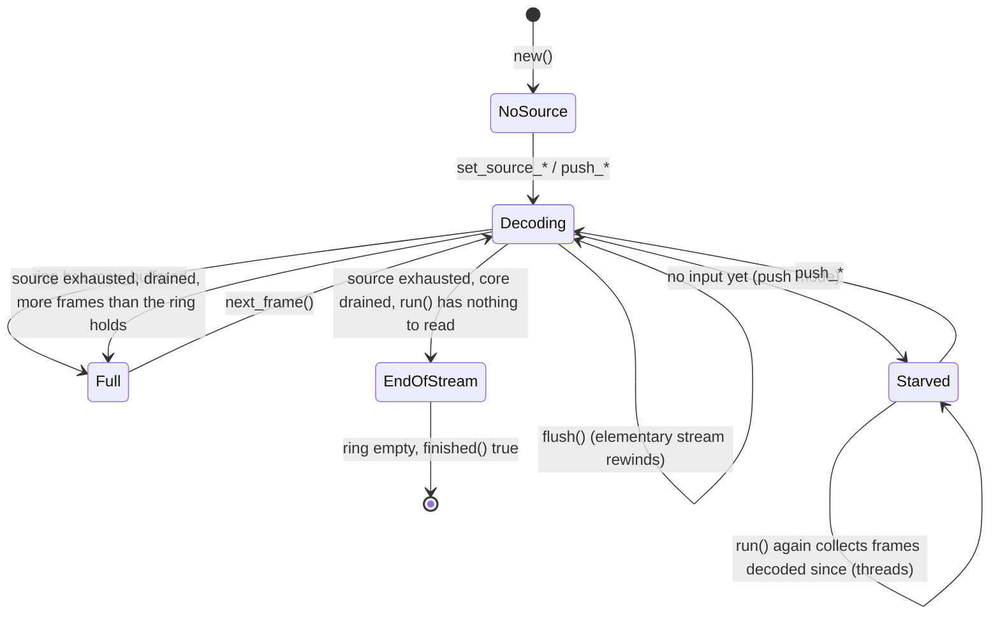

# Decoder core

> **Status:** PARTIAL — frame-by-frame equal to rivet-h26x's own decoder on every fixture, on 1, 2 and 4 threads; but a frame's pts is assigned by assumption (every pts that goes in gets a frame), and a picture that is never output shifts every later pts by one.
> **Owners (code):** `src/decoder.rs`, `src/core.rs`, `src/units.rs`, `src/wasm.rs`, `src/lib.rs`
> **Related docs:** [input-sources.md](./input-sources.md), [frames-and-rendering.md](./frames-and-rendering.md), [variants-and-threading.md](./variants-and-threading.md), [`../performance.md`](../performance.md)
> **Last verified against code:** 2026-11-15 @ `616be49`

## Overview

`Decoder` wraps an H.264 or H.265 decoder and a ring of decoded frames,
driven the way upstream wasm-av1 drove libaom and the way wasm-av1 drives
rivet-av1: the caller asks for a bounded step of work (`run`), pops frames
(`next_frame`), and asks whether it is done (`finished`). The file is
wasm-av1's, with an Annex-B elementary stream where wasm-av1 has IVF and
access units where it has temporal units (`src/decoder.rs:1-29`). The same
Rust type is used natively (tests, `examples/decode.rs`) and in wasm
through `H26xDecoder` (`src/wasm.rs:107-588`).

The decoder underneath is **rivet-h26x** (crate `rivet-h26x`, imported as
`h26x`): rivet's own H.264 and H.265 decoders, written from the ITU-T
Recommendations. It takes NAL units in decode order and hands back cropped,
packed pictures in output order. The private `core` module (`src/core.rs`)
is the adapter, and with the thread hook in `src/threads.rs` the only code
that names it. Speed: see [`../performance.md`](../performance.md).

What the adapter has to supply that rivet-av1 did not need: **access-unit
boundaries and output timestamps.** rivet-h26x finds picture boundaries
itself, but an elementary stream has to be cut into access units so that
`run()` stays bounded, and a pts that comes in with an access unit has to
leave on the right frame, although frames leave in output order, not
decode order. `src/units.rs` (`Tracker`) does both from NAL unit headers
and the first fields of each slice header (H.264 7.4.1.2, H.265 7.4.2.4).

**Frames do not come out with the unit that carried them, on any thread
count.** A picture is complete only once the next one begins (or the input
ends), and leaves when the reorder buffer lets it, so a stream with
B-pictures holds a few frames back even on one thread. With more than one
thread rivet-h26x also decodes several pictures at once on a pool, and the
delay grows by a few units.

## How it works today

### Data model

`Decoder` (`src/decoder.rs:201-229`) holds:

- `inner`: the core (`src/core.rs:97-109`): `codec`, `dec` (an
  `h26x::h264::H264Decoder` or `h26x::hevc::HevcDecoder`, boxed, made by the
  first unit after a reset, `src/core.rs:54-59`, `172`), the `Tracker`
  (`src/units.rs:144-161`), `pending` (the pts of units whose frames have
  not come out, ascending, each with the colour description it came
  under), `ready` (frames decoded and not pulled) and `dropped` (always 0
  today, kept for the shape of `decoder.rs`, `src/core.rs:261-263`).
- `source`: `AnnexB`, `Container` or `Push` (`src/decoder.rs:152-165`);
  see [input-sources.md](./input-sources.md).
- `ring: VecDeque<Frame>`, capped at `Config::max_buffered` (default 10,
  upstream's `NUM_FRAMES_BUFFERED`, `src/decoder.rs:43`), and `current`, the
  frame last popped, which stays readable until the next pop.
- `last_size`: the last decoded frame's size, what `width()`/`height()`
  answer when no container header says (`src/decoder.rs:211`, `634-645`).
- `Stats` (`src/decoder.rs:140-145`): access units in, bytes in, frames
  out, decode errors. Never reset, including by `flush`.

### Interfaces

| Kind | Name | Notes |
|---|---|---|
| Rust | `Decoder::new(Config)` | `Config { max_buffered, threads }` (`src/decoder.rs:46-70`). Returns `Result`, and cannot fail with this core (`252-271`) |
| Rust | `run() -> RunOutcome` | `Full`, `Consumed`, `Starved`, `EndOfStream` (`src/decoder.rs:126-136`) |
| Rust | `run_until_full()` | `run` until anything but `Consumed` (`src/decoder.rs:759-766`) |
| Rust | `next_frame`, `peek_next`, `current_frame`, `take_current_frame` | `src/decoder.rs:737-756` |
| Rust | `finished()` | `src/decoder.rs:618-620` |
| Rust | `units_in_flight()` | Pts waiting for their frames, with more than one thread; always 0 with one (`src/decoder.rs:602-604`, `src/core.rs:270-276`) |
| Rust | `codec()`, `set_codec(label)` | `src/decoder.rs:282-296`; a change of codec resets |
| Rust | `flush()` | `src/decoder.rs:561-574` |
| wasm | `new H26xDecoder(maxBuffered?, threads?, codec?)` | `src/wasm.rs:138-157`; `threads()` reports what applied, `codec()` what is known |
| wasm | `run`, `runUntilFull`, `framesBuffered`, `unitsInFlight`, `finished`, `stats`, `flush` | `src/wasm.rs:322-370`; `RunResult` is the enum as 0-3 (`src/wasm.rs:72-77`) |
| wasm | `width`, `height`, `timeBaseNum/Den`, `frameCountHint`, `frameRateHint`, `durationHint` | `src/wasm.rs:375-435` |
| wasm | `simdEnabled`, `threadsSupported`, `threadWorkersSpawned`, `containerSupport`, `version` | free functions, `src/wasm.rs:29-67` |

`Config::threads` is the number of threads rivet-h26x decodes with:
several pictures at once (frame threading, both codecs), and the wavefront
rows, tiles and slice segments of an H.265 picture. On wasm it is forced to
1 unless the build has atomics (`effective_threads`,
`src/decoder.rs:232-238`; see
[variants-and-threading.md](./variants-and-threading.md)). There is no
`apply_grain`: neither codec has film grain synthesis in the decoder.

Errors (`src/decoder.rs:73-92`): `AnnexB` (not an elementary stream, or
neither codec), `Container`, `Open` (never returned: nothing in rivet-h26x
can fail when a decoder is made), `Decode` (the core refused a NAL unit;
the rest of the unit was still pushed and the decoder stays usable),
`NoSource`, `UnknownCodec`. `Decode` carries `h26x::Error`, exported as
`wasm_h26x::CoreError` (`src/core.rs:42`), `Bitstream` or `Unsupported`
with a message. In wasm every error becomes a thrown `JsError` with the
`Display` text, which for a decode error begins `rivet-h26x: `
(`src/decoder.rs:101`).

### Flow

`run()` (`src/decoder.rs:653-717`), in order:

1. No source: `NoSource`. Ring full: `Full`, nothing read.
2. Frames the core has ready go into the ring first (`collect_pictures`,
   `src/decoder.rs:721-731`); if that fills it, `Full`.
3. Take the next access unit from the source. None available and the
   source not exhausted: `Starved`. None available and the source
   exhausted: the core's `finish` (`src/core.rs:235-246`) flushes
   rivet-h26x, waits for every picture still in it, clears whatever pts
   are left (no frame will come for them), and the frames are collected;
   `Full` if they did not all fit into the ring, else `EndOfStream`.
4. Otherwise `send(data, pts)` (`src/core.rs:161-202`): the unit is split
   at its start codes; each NAL unit goes through the `Tracker` and then to
   rivet-h26x's `push_nal`. Every NAL unit the tracker says begins an
   output frame (`NalEvent::new_frame`, `src/units.rs:101-113`) puts the
   unit's pts into `pending`, kept sorted (`src/core.rs:196-199`). Then
   the finished pictures are taken without waiting (`try_next_picture`),
   and **each takes the smallest pending pts** (`src/core.rs:206-230`).
   `run` returns `Consumed`; a `Decode` error counts in `decode_errors`
   and propagates after the frames are collected.

**Why the smallest pts.** rivet-h26x outputs in output order, which in a
conforming stream is presentation order, so the next frame out is always
the one with the earliest pts not yet given out (`src/core.rs:12-20`).
That holds only if every pts put in has exactly one frame coming out. The
tracker therefore leaves out the units whose pictures are not output on
their own: the second field of an H.264 field pair (`src/units.rs:240-264`)
and an H.265 RASL picture the decoder skips because its IRAP started the
stream, followed an end of sequence, or was an IDR/BLA
(`src/units.rs:376-386`). Where the assumption fails, see Edge cases.

**H.264 SPS change.** When an H.264 SPS replaces a different one of the
same id (a new size, another rendition), `send` first calls rivet-h26x's
`flush()` (`src/core.rs:181-190`, flag set at `src/units.rs:279`). The new
IDR picture would output every picture still waiting, and rivet-h26x's
H.264 DPB crops whatever it outputs with the window of the newest SPS (it
keeps one window, not one per picture), so the waiting pictures are output
first, under the window they were decoded with. It is a workaround for
that behaviour, not something the standard asks for; H.265 is not
affected, its DPB keeps the window per picture.

`finished()` is source exhausted, nothing pending in the core, **and**
every decoded frame popped (`src/decoder.rs:618-620`, `src/core.rs:280-282`).
At the end of a source it needs the `run()` of step 3 first, which drains
the decoder, on any thread count.

`units_in_flight()` is what a caller polls on between `run()`s with
threads: after a `Starved`, while it is not 0, a later `run()` may collect
frames with no new input. It is `pending.len()` (`src/core.rs:270-276`):
the pictures being decoded on the pool **and** those waiting in the
reorder buffer for later pictures, which only more input or the end of
the source releases. It is therefore an upper bound. The decode Worker
re-polls every 4 ms while it is not 0 (`repoll`, `js/worker.js:37-44`,
`82-87`).

`flush()` calls `reset_state` (`src/decoder.rs:580-586`: the core's `flush`,
ring cleared, `last_sent_pts` forgotten) and then: an elementary stream
rewinds, a container source is **dropped** (rivet is forward-only), push
mode clears its queue. rivet-h26x has no reset, so the core's `flush`
(`src/core.rs:146-154`) drops the decoder; the next unit makes a new one.
The tracker restarts (`src/units.rs:186-192`): parameter sets are kept, and
the next H.265 IRAP is treated as the start of a stream. On a threads build
dropping the decoder waits until each of its pool's workers has left the
pool; the Workers that ran them are kept for the next decoder
([variants-and-threading.md](./variants-and-threading.md)).

### Configuration

Cargo features (`Cargo.toml:50-53`): `container` (rivet's demuxers), on by
default, and nothing else. rivet-h26x is not optional and has no build
options: both codecs and every bit depth up to 16 are always in. It is
taken from rivet `main`, but `Cargo.toml:62-63` patches it to the
`wasm/threads` branch of `safewords/rivet-h26x-codecs` at `a26393e`, which
carries the `h26x::platform` hook the threads builds need
([build-and-release.md](./build-and-release.md)). The release profile is
fat LTO, one codegen unit, `panic = "abort"` (`Cargo.toml:65-71`), so a
panic in wasm is a trap, not an exception.

### Edge cases & gotchas

- **A picture that is never output shifts every later pts.** Its pts
  stays in `pending`, and from then on each frame takes the pts of the one
  before it, until the source ends (`finish` clears the queue) or a flush.
  That happens when rivet-h26x refuses a picture's slices, and wherever the
  tracker's idea of what is output differs from the decoder's: an H.265
  picture with `pic_output_flag` 0, pictures discarded unshown by
  `no_output_of_prior_pics_flag`, or a RASL picture the two disagree about.
  Nothing detects the shift. The reverse (more frames than pts) gives
  frames a `None` pts (`src/core.rs:217-228`), and the player falls back to
  counting frames. Field pairing and RASL skipping are not covered by any
  fixture (all are progressive, and every stream starts at an IDR).
- **The pts of a unit is presentation time; the order it arrives in is not
  checked.** Units pushed with pts that do not follow output order (a
  wrong edit list, a caller passing decode timestamps) come out with the
  pts sorted, not with their own.
- `Stats` survive `flush()`; consumers that compare them with their own
  counters after a seek (see `js/hls.js`) drift.
- `pushAccessUnit`'s `pts` crosses the wasm boundary as `f64` and is cast to
  `i64` (`src/wasm.rs:251-255`); `NaN` becomes 0.
- **A damaged picture is not dropped as a unit.** `send` pushes every NAL
  unit of the access unit even after one is refused and reports the first
  error (`src/core.rs:174-201`); what rivet-h26x makes of the rest is its
  own. The error counts once in `decode_errors`.
- **The codec is guessed when nobody says.** `sniff` scores the first 32
  NAL units against both header layouts (`src/units.rs:69-97`). It decides
  only when one codec scores higher; a caller that knows should pass
  `codec`. Given explicitly, it is believed: H.265 data given to the H.264
  decoder produces no frames and no panic (`tests/decode.rs`,
  `codec_is_told_from_the_stream_or_given`).
- **With threads, frames and errors are later still.** `run()` collects
  only pictures already finished (`try_next_picture`); a caller that feeds
  one unit and expects its frame from the same `run()` gets it a few calls
  later, or at the end of the input. An error is reported by the `run()`
  whose unit was refused, since rivet-h26x reports errors as data goes in.
- **The H.264 SPS-change drain stalls with threads.** `flush()` waits for
  every picture in flight before the new sequence's first picture is
  pushed. And it fires only on a changed SPS of the *same* id; a rendition
  that switches to an SPS under another id with a different cropping
  window is cropped wrongly for the pictures still waiting.

## History & references

- `1a7e686` (2026-11-15): the crate, wasm-av1's `decoder.rs` around
  rivet-h26x, with `units.rs` and `annexb.rs` new.
- Upstream: GoogleChromeLabs/wasm-av1 `decode-av1.c` (`AVX_Decoder_*`), by
  way of wasm-av1.
- `tests/decode.rs`: every elementary-stream fixture equals rivet-h26x's
  `h26xdec` frame by frame (per-frame MD5 in `testdata/*.md5`) on 1, 2 and
  4 threads, with pts 0, 1, 2… in presentation order; push mode equals the
  elementary stream (1 and 3 threads); flush rewinds; the ring and
  `finished`; the codec told or given; the VUI frame rate. Run on
  2026-11-15 on macOS aarch64: 17 unit, 7 decode and 3 container tests
  pass with `cargo test --release`.

## Proposed / Ideas (backlog)

| Idea | Motivation | Sketch | Status |
|---|---|---|---|
| Take the pts from rivet-h26x | No assumption about which pictures are output | rivet-h26x carries an opaque per-picture tag from `push_nal` to `Picture`; the core stops sorting | Proposed |
| Crop per picture in rivet-h26x's H.264 DPB | Drop the SPS-change drain and its stall | Keep the window on the DPB entry, as its H.265 DPB does | Proposed |
| Interlaced and open-GOP fixtures | The tracker's field pairing and RASL skipping are untested | PAFF/MBAFF H.264 and an x265 open-GOP stream cut at a CRA in `make-fixtures.sh` | Proposed |
| Reset `Stats` on source change | Comparable counters after a seek | Zero in `reset_state`, or expose a `since_reset` copy | Proposed |
