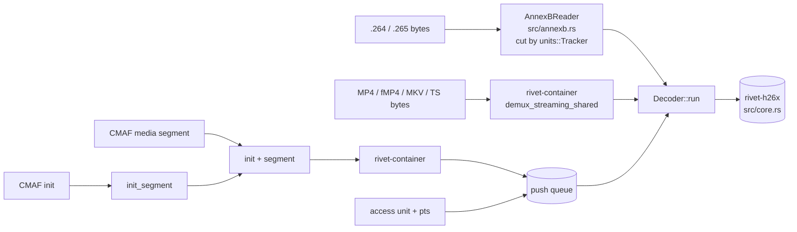

# Input sources

> **Status:** PARTIAL — elementary streams, the four containers, CMAF segments of both codecs (H.265 with an open GOP across the boundary) and H.264 rendition switches are tested; an H.265 switch onto an open-GOP segment loses that segment's leading pictures, and a switch to the other codec is not handled.
> **Owners (code):** `src/decoder.rs`, `src/annexb.rs`, `src/units.rs`, `src/wasm.rs` (input section), `js/decoder.js` (`sniff`, `switchStream`)
> **Related docs:** [decoder-core.md](./decoder-core.md), [player-and-hls.md](./player-and-hls.md), [`../rivet.md`](../rivet.md), [`../integration.md`](../integration.md)
> **Last verified against code:** 2026-11-15 @ `bb70073`

## Overview

The decoder accepts H.264 and H.265 four ways: a whole Annex-B elementary
stream (`.264`, `.265`, what IVF is for wasm-av1), a whole container file
demuxed by rivet inside the wasm, CMAF segments pushed one at a time
against an init segment, or access units pushed by a caller that demuxed
them itself. Only one source is active; switching mode resets the decoder,
except that the two push forms share one queue. Every form ends up as
access units (Annex-B framed, parameter sets in band) with a pts.



## How it works today

### Interfaces

| wasm (`H26xDecoder`) | Rust (`Decoder`) | Mode | Notes |
|---|---|---|---|
| `setSourceAnnexB(bytes, codec?)` | `set_source_annexb` (`src/decoder.rs:301-314`) | Elementary stream | Copies the stream in and cuts it into access units up front; `codec` `"h264"`/`"hevc"`, or absent / `"auto"` to sniff (`src/wasm.rs:116-123`, `185-191`) |
| `setSourceContainer(bytes)` | `set_source_container` (`src/decoder.rs:329-343`) | Container | MP4/MOV, fMP4/CMAF, Matroska/WebM, MPEG-TS; rejects a video track that is neither codec (`container_codec`, `241-249`) |
| `setInitSegment(init)` | `set_init_segment` (`src/decoder.rs:363-376`) | Push | Keeps `ftyp`+`moov`; a second one marks a new sequence (below) |
| `pushSegment(seg)` | `push_segment` (`src/decoder.rs:384-436`) | Push | Demuxes `init ‖ segment`, queues every sample; returns the count |
| `pushAccessUnit(nals, pts)` | `push_access_unit` (`src/decoder.rs:486-499`) | Push | One access unit, start codes and parameter sets in band |
| `setCodec(label)`, ctor `codec` | `set_codec` (`src/decoder.rs:289-296`) | Push | Otherwise the first unit's NAL units decide; a change resets |
| `endOfStream()` | `end_of_stream` (`src/decoder.rs:503-507`) | Push | Lets `finished` become true |
| `truncateQueuedFrom(pts)` | `truncate_queued_from` (`src/decoder.rs:545-555`) | Push | Drops queued, undecoded units with `pts >= pts` |
| `pendingInput`, `nextQueuedPts`, `lastSentPts`, `lastSegmentFirstPts/LastPts` | `src/decoder.rs:510-529`, `444-446` | Push | What a rendition switch needs to pick a safe boundary |

JS: `Decoder.setSource(bytes, codec?)` sniffs the first bytes
(`js/decoder.js:138-149`: zero bytes then `0x01` is `'annexb'`; `ftyp`,
`moof` or `styp` at offset 4 is `'mp4'`; EBML is `'mkv'`; `0x47` at 0 and
188 is `'ts'`) and sends an elementary stream to `setSourceAnnexB`,
everything else to `setSourceContainer` (`js/decoder.js:202-204`).
`pushTemporalUnit` is kept as an alias of `pushAccessUnit` so code written
against wasm-av1 runs unchanged (`js/decoder.js:233-235`).

### Flow

**Elementary stream.** `AnnexBReader::new` (`src/annexb.rs:74-125`) checks
for a leading start code, picks the codec (given, or `units::sniff`), and
walks every NAL unit once through a `Tracker`: a unit ends where the next
NAL unit opens one (`NalEvent::starts_unit`; H.264 7.4.1.2.3, H.265
7.4.2.4.4). Each unit's pts is the number of output frames begun before it
in decode order (`src/annexb.rs:99-111`); since each frame takes the
smallest pts not given out ([decoder-core.md](./decoder-core.md)), frames
come out numbered 0, 1, 2… in presentation order. The time base is the
frame duration in the SPS's VUI timing information (`src/annexb.rs:142-147`;
for H.264 twice `num_units_in_tick` over `time_scale`, since its ticks are
fields, `src/units.rs:282-286`); without one it is unknown and the player
uses its fallback rate. Cutting up front gives the frame count
(`frameCountHint`) and a free rewind: `flush` goes back to the first unit
(`src/annexb.rs:164-166`). A stream that is cut short decodes as far as it
goes: its last unit is simply shorter, may fail once in `run()`, and the
reader moves on (`src/annexb.rs:150-157`).

**Container.** rivet's streaming demuxer is boxed in the source; each
`run()` asks it for `next_video_sample()` (`src/decoder.rs:670-684`).
rivet hands H.264/H.265 samples over as Annex-B with the `avcC`/`hvcC`
parameter sets in front of the first. A damaged sample is reported as an
error and counted, and the demuxer is assumed to continue. Time base is
`(1, timescale)` (`src/decoder.rs:461-472`). Containers are forward-only:
`flush` drops the source and the caller must set it again.

**CMAF segments.** `push_segment` prepends the remembered init segment and
demuxes the pair as one file, so the decoder is never reset between
segments. rivet puts the init segment's parameter sets in front of each
segment's first sample, so a new init segment (a rendition switch) needs
nothing more for H.264: the decoder meets the new SPS and PPS before the
segment's first picture, which in a CMAF H.264 segment is an IDR
(`src/decoder.rs:353-361`). For H.265, `set_init_segment` called a second
time sets `new_sequence` (`src/decoder.rs:372`), and the first sample of
the next segment gets an end-of-sequence NAL unit (type 36) in front
(`src/decoder.rs:420-423`). The decoder (and the tracker, `src/units.rs:409-414`)
then treats that segment's IRAP as the start of a stream: if it is a CRA,
its RASL pictures, which refer to pictures of the other rendition that the
decoder never had, are skipped instead of decoded from the wrong
references.

**Seamless rendition switch.** `Decoder.switchStream({boundaryPts, init})`
(`js/decoder.js:289-299`) checks the decoder has not reached the boundary
(`nextQueuedPts` / `lastSentPts`), truncates the queue at it, and installs
the new init segment; segments of the other rung from that boundary
follow. Nothing decoded is lost and nothing is flushed. Truncating by pts
works with B-pictures because a closed segment's pictures all show before
the next segment's first (`src/decoder.rs:531-544`).

```mermaid
sequenceDiagram
  participant H as HlsH26xVideo
  participant D as Decoder (push mode)
  H->>D: setInitSegment(init A)
  loop segments of rung A
    H->>D: pushSegment(seg A_i)
  end
  Note over H: bandwidth says switch
  H->>D: switchStream(boundaryPts = first pts of A_b, init B)
  alt decoder already past A_b
    D-->>H: ok false, try the next boundary
  else
    D-->>H: ok true, dropped n
    H->>D: pushSegment(seg B_b) and on
    Note over D: B's SPS/PPS lead the first sample; H.265 also gets an end of sequence
    Note over D: H.264: a changed SPS drains the DPB first (decoder-core.md)
  end
```

### Edge cases & gotchas

- **An H.265 switch onto an open-GOP segment loses its leading pictures.**
  The RASL pictures of the CRA that opens the new rendition's first
  segment are skipped, so the frames they would have shown (between the
  last picture of the old rendition and the CRA) are missing, and the
  player holds the previous frame for that long. x265 encodes open GOPs by
  default. The same happens after a seek or a hard switch, where a flush
  restarts the stream at a CRA. A closed-GOP ladder (IDR at every segment)
  loses nothing. This path is reasoned from the code and H.265 8.1.3, not
  tested: `testdata/cmaf-hevc` has an open GOP across its segment
  boundary, but its tests push both segments under one init segment,
  where no end of sequence goes in and the RASL pictures are decoded
  (`tests/container.rs`, `cmaf_segments_decode_continuously`). There is
  no second H.265 rendition to switch to.
- **A switch to the other codec is not handled.** `push_segment` of a
  segment of the other codec calls `set_codec` (`src/decoder.rs:402-406`),
  which resets the core: frames decoded and not yet in the ring are lost,
  and the units of the old codec still queued before the boundary are then
  fed to the new codec's decoder. `HlsH26xVideo.variantForBandwidth` does
  not keep to one codec (`js/hls.js:257-266`). A ladder that mixes H.264
  and H.265 rungs should be given to it one codec at a time.
- `setInitSegment` and `pushSegment` switch to push mode **keeping** queued
  and decoded frames if already in push mode; from an elementary-stream or
  container source they reset.
- `pushSegment` that fails half way leaves the samples before the error
  queued, counts one decode error, and does not update `lastSegment*Pts`
  (`src/decoder.rs:428-431`).
- `lastSegmentFirstPts` is the smallest pts in the segment, which for an
  open-GOP H.265 segment is a RASL picture's, not the CRA's.
- Without the `container` feature, the container and segment entry points
  throw and elementary streams / pushed access units still work
  (`src/wasm.rs:198-246`).
- `sniff` calls anything that starts with two or more zero bytes and a
  `0x01` an elementary stream, so an MP4 whose first box uses a 64-bit size
  (size field `00 00 00 01`) is sent to `setSourceAnnexB` and rejected. Pass
  it to `setSourceContainer` directly.
- The time base of an elementary stream comes from the last SPS in it that
  has VUI timing (`src/annexb.rs:142-147`); the tracker overwrites it on
  each such SPS (`src/units.rs:280-286`, `398-402`). A stream normally
  repeats one SPS, so this matters only for one that changes its rate.

## History & references

- [`../rivet.md`](../rivet.md): what `rivet-container` demuxes and which rivet
  commit lets it build for wasm32 without `rivet-codec`.
- `1a7e686` (2026-11-15): `annexb.rs` (in place of wasm-av1's `ivf.rs`),
  `units.rs`, and the end-of-sequence NAL unit after a second H.265 init
  segment. The `av1C` configOBU handling of wasm-av1 is gone: rivet puts
  the parameter sets in band itself.
- `tests/container.rs`: MP4, fMP4, Matroska and TS of the H.264 fixture,
  and MP4, Matroska and TS of the H.265 one, equal the elementary stream
  frame by frame on 1 and 4 threads; CMAF segments one by one, H.264 and
  H.265, equal to the elementary stream (`30688b9` added the H.265 one,
  `testdata/cmaf-hevc`, x265 with an open GOP: the second segment begins
  with a CRA whose RASL pictures refer to the first, and they are decoded;
  ffmpeg's HLS muxer writes one composition time twice at that boundary,
  so the test checks those pts only for order); an H.264
  rendition switch at a segment boundary is seamless and exact on both
  sides of it.

## Proposed / Ideas (backlog)

| Idea | Motivation | Sketch | Status |
|---|---|---|---|
| A second H.265 rendition | The end-of-sequence path and the RASL loss at a switch are untested | A lower x265 rung next to `testdata/cmaf-hevc` in `make-fixtures.sh`, a switch test like the H.264 one | Proposed |
| Keep the RASL pictures of a switch | No hold at an open-GOP switch | Switch only at segments that start with an IDR, or overlap one segment of both rungs and splice after the CRA | Proposed |
| One codec per decoder in push mode | Mixed ladders | Refuse a segment of the other codec, or flush and drop the old queue explicitly; `variantForBandwidth` filters by the playing codec | Proposed |
| Byte-range segments | HLS `EXT-X-BYTERANGE` ladders | Range fetches in `hls.js`; the decoder side needs nothing | Proposed |
