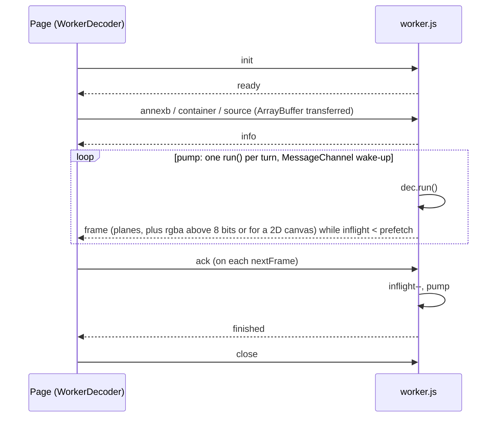

# JS decoder API and the decode Worker

> **Status:** PARTIAL — works and is covered by the Node tests and the browser matrix; the flush/reload races and the `load()` hang of wasm-av1 are carried over unchanged.
> **Owners (code):** `js/index.js`, `js/decoder.js`, `js/worker.js`, `js/worker-client.js`
> **Related docs:** [decoder-core.md](./decoder-core.md), [frames-and-rendering.md](./frames-and-rendering.md), [variants-and-threading.md](./variants-and-threading.md), [player-and-hls.md](./player-and-hls.md)
> **Last verified against code:** 2026-11-15 @ `616be49`

## Overview

`Decoder` (`js/decoder.js:154-406`) is a thin JS shape over the wasm
`H26xDecoder`: typed views instead of pointers, `null` instead of `NaN`, a
`timeBase` in seconds per tick, and generation checks on frames.
`WorkerDecoder` (`js/worker-client.js:7-262`) offers the same feed/pull
shape from the page while `js/worker.js` owns a `Decoder` in a Worker and
posts frames as transferable buffers. Everything is exported from
`js/index.js:14-20`. All of it is wasm-av1's JS with the names changed
(`loadWasmH26x`, `H26xDecoder`, `setSourceAnnexB`, `pushAccessUnit`), a
`codec` option added, and `pushTemporalUnit` kept as an alias so code
written against wasm-av1 runs unchanged.

## How it works today

### Interfaces

`Decoder` (in-thread): `setSourceAnnexB(bytes, codec?)`,
`setSourceContainer`, `setSource(bytes, codec?)`, `codec`, `setCodec`,
`pushAccessUnit` (alias `pushTemporalUnit`), `setInitSegment`,
`pushSegment`, `lastSegmentRange`, `nextQueuedPts`, `lastSentPts`,
`truncateQueuedFrom`, `switchStream`, `setTimeBase`, `endOfStream`,
`flush`, `run`, `runUntilFull`, `framesBuffered`, `unitsInFlight`,
`finished`, `pendingInput`, `info()` (now with `codec`), `stats()`
(`accessUnitsIn`, `bytesIn`, `framesOut`, `decodeErrors`), `secondsOf`,
`peekPts`, `peekSeconds`, `nextFrame`, `currentFrame`, `free`. Options:
`maxBuffered`, `threads`, `codec` (`js/decoder.js:163-173`); there is no
`applyGrain`. `Run` mirrors the wasm `RunResult` (`js/decoder.js:152`).

Worker protocol (`js/worker.js:10-11`):

| Direction | Message | Handler | Notes |
|---|---|---|---|
| in | `init {variant, baseUrl, output, prefetch, maxBuffered, codec, threads}` | `js/worker.js:98-106` | Answers `ready {variant, simd, threads, version}` |
| in | `annexb` / `container` / `source {data, codec}` | `107-118` | Resets `inflight`, answers `info` |
| in | `push {data, pts, timeBase}` | `119-124` | |
| in | `initSegment {data}` | `125-127` | No reply |
| in | `segment {data, tag}` | `128-140` | Answers `segment {tag, samples, error, firstPts, lastPts, timeBase, info}` |
| in | `switchStream {boundaryPts, init, tag}` | `141-152` | Answers `switched {tag, ok, dropped}` |
| in | `eos`, `flush`, `ack {count}`, `close` | `153-172` | `flush` answers `flushed` |
| out | `frame {frame, stats}` | `pump`, `50-92` | `frame` is `Frame.toTransferable()`; `data` (and `rgba`) transferred |
| out | `finished`, `error {message, fatal}`, `spawnThread` | | `fatal` only for a failed `init` |

`WorkerDecoder` turns `segment` and `switchStream` into promises keyed by
`tag` (`js/worker-client.js:122-136`), queues frames, and acks each one
taken with `nextFrame()`; `frame()` awaits the next one or `null` at the
end.

### Flow

The pump (`js/worker.js:50-92`) does one `run()` per turn, ships frames
while fewer than `prefetch` (default 6) are unacknowledged, and reschedules
itself through a `MessageChannel` so incoming messages interleave. Output
is `'planes'` for WebGL or `'rgba'` for a 2D canvas (converted in the
Worker); in `'planes'` mode a frame above 8 bits, or planar GBR, carries
RGBA too, because that is how the WebGL renderer draws it
(`js/worker.js:69-72`). One copy per frame out of wasm memory is
unavoidable (wasm memory cannot be transferred); a frame above 8 bits costs
two.

### Edge cases & gotchas

- **Stale frames after `flush()` or a new source.** The page clears its
  queue (`js/worker-client.js:138-144`, `205-209`), but `frame` messages
  already in flight from the Worker arrive afterwards and are queued, and
  their acks then undercount. No generation travels with the messages.
  Expect a few frames of the old position after a seek or a reload.
- **`H26xPlayer.load()` can hang in Worker mode.** It polls `src.info`
  every 5 ms (`js/player.js:126`, `133-138`); a source the Worker rejects
  (not an elementary stream, a container with neither codec) produces an
  `error`, not an `info`, so the promise never settles.
- **Errors in `run()` are retried.** The pump treats a throw as `CONSUMED`
  and reschedules (`js/worker.js:59-64`). wasm-av1's busy loop on a
  truncated IVF does not happen here: an elementary stream is cut into
  units up front and the reader moves past a damaged one, and rivet's MP4
  demuxer ends at a sample that runs past the data instead of failing
  again. Each damaged unit is one `error` message.
- `finished` is posted again on every `ack` after the end.
- **Frames come late, and `unitsInFlight` overstates.** Frames leave in
  output order, a few units after their data went in (more with threads).
  When `run()` has no input left and `unitsInFlight` is not 0 the Worker
  looks again every 4 ms (`js/worker.js:82-87`). `unitsInFlight` also
  counts pictures that only more input or `eos` can release, so on a live
  stream that is waiting for input this polling continues until one comes;
  with one thread it is always 0 and the Worker simply waits. A caller
  driving `Decoder` itself has to do the same: `Run.STARVED` with
  `unitsInFlight > 0` means frames may still be coming, and only
  `endOfStream()` releases the last pictures of a reordered stream.
- **`codec`** is passed through `init` and the source messages; without it
  the decoder sniffs the NAL units ([decoder-core.md](./decoder-core.md)).
  A `push` stream's codec can only be given at `init`; the Worker has no
  `setCodec` message.
- If the Worker dies, outstanding `_request` promises never resolve.
- Bundlers only recognise the Worker if the URL is built inline in `new
  Worker(new URL(...))`; serving `js/` statically and passing `workerUrl` is
  the predictable route (`js/worker-client.js:36-43`).

## History & references

- `55e3c2b` (2026-11-15): the JS API, wasm-av1's renamed, with `codec`,
  `setSourceAnnexB`, `pushAccessUnit` and RGBA for frames above 8 bits in
  `'planes'` mode.
- Upstream listed "offloading the decoding into a web worker" as future
  work; `js/worker.js` is wasm-av1's answer, reused.
- `test/decode.test.mjs`: push mode, errors, VUI frame rate, containers,
  segments and a rung switch through the JS `Decoder`, `sniff` and the HLS
  CODECS helpers. `test/browser.mjs`: Chromium, Firefox, WebKit, main
  thread and Worker.

## Proposed / Ideas (backlog)

| Idea | Motivation | Sketch | Status |
|---|---|---|---|
| Generation on source/flush | Drop stale frames | Page sends `gen`; Worker stamps frames; client ignores old ones | Proposed |
| `info` or `error` as a reply | `load()` cannot hang | Make `source` a tagged `_request` that rejects on error | Proposed |
| `setCodec` message | Say the codec of a pushed stream after `init` | Forward to `Decoder.setCodec` | Proposed |
