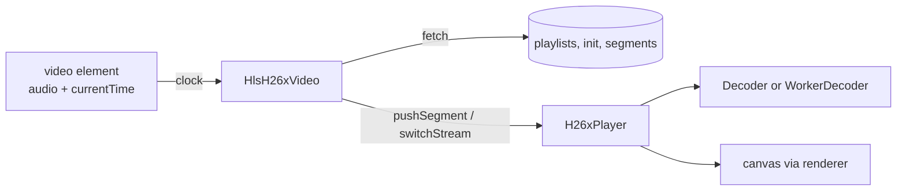

# H26xPlayer and HlsH26xVideo

> **Status:** PARTIAL — wasm-av1's player and HLS layer, unchanged but for the decoder; an H.264 CMAF ladder plays and switches rung in Chromium, Firefox and WebKit, but no H.265 ladder has been played through it.
> **Owners (code):** `js/player.js`, `js/hls.js`, `demo/index.html`
> **Related docs:** [js-api-and-worker.md](./js-api-and-worker.md), [input-sources.md](./input-sources.md), [frames-and-rendering.md](./frames-and-rendering.md), [`../integration.md`](../integration.md)
> **Last verified against code:** 2026-11-15 @ `616be49`

## Overview

`H26xPlayer` (`js/player.js:28-312`) is a deliberately small canvas player:
a `requestAnimationFrame` loop that shows frames at `pts × timeBase`, drops
late ones, decodes within a per-tick budget, and measures stutter. It is a
reference for an integration, not a full player: no audio, no seek UI.
`HlsH26xVideo` (`js/hls.js:192-463`) builds on it for the case a site has
when the browser cannot decode the video rendition itself (H.265 in
Firefox and on machines without hardware HEVC, H.264 in builds without the
licensed decoder): keep the `<video>` for the audio rendition and the
clock, paint the video rendition on a `<canvas>` from HLS/CMAF segments.
Both are wasm-av1's `Av1Player` and `HlsAv1Video` with the decoder swapped,
`applyGrain` replaced by `codec`, and the CODECS test matching `avc1`/`avc3`
and `hvc1`/`hev1` instead of `av01`.

## How it works today

### Interfaces

| Class | Members | Notes |
|---|---|---|
| `H26xPlayer(canvas, opts)` | `init`, `load(bytes)`, `openStream({timeBase})`, `pushAccessUnit` (alias `pushTemporalUnit`), `endOfStream`, `play`, `pause`, `stop`, `destroy`, `stats`, `onstate/onstats/onerror` | Options: `renderer`, `worker`, `workerUrl`, `variant`, `threads` (number or `'auto'`), `baseUrl`, `maxBuffered`, `codec`, `decodeBudgetMs` (8), `fallbackFps` (24), `clock` (`js/player.js:29-51`) |
| `HlsH26xVideo(canvas, opts)` | `loadMaster`, `selectVariant(v, {at})`, `variantForBandwidth`, `start`, `stop`, `seek`, `destroy`, `stats`, `onvariant/onerror` | Adds `clock` (required), `fetchBytes`, `fetchText`, `prefetchSeconds` (8), `maxBuffered` (16), `bandwidthEstimate` (`js/hls.js:193-203`) |
| Helpers | `parseMaster` (variants carry `h26x` and `codec`), `parseMediaPlaylist`, `h26xCodecOf`, `isH26xCodecs`, `BandwidthEstimator`, `resolveThreads` | `js/hls.js:46-56`, `62`, `105`, `140-171`, `js/player.js:20-26` |

`stats` (`js/player.js:64-81`, plus `js/hls.js:239-248`): frames shown,
dropped and late, stalls and stall time, decode and draw ms, fps,
buffered, variant, simd, threads, renderer, draw path, decoder counters
(`accessUnitsIn`, …), bandwidth, buffer ahead, slow fetches, rung in
effect.

### Flow: the player loop

`_loop` (`js/player.js:232-311`): read the clock (external, or free-running
from `play()`); pop frames whose due time has passed, dropping each one
whose successor is also due; account lateness and stalls; draw; then
`_decodeSome` (`js/player.js:211-230`) runs the in-thread decoder until the
ring is full, input runs out or `decodeBudgetMs` is spent (the Worker
decodes on its own). It ends when the source reports `finished` with
nothing buffered. A frame is due at its `seconds`, else `pts × timeBase`,
else its index over the frame rate (`_peekDue`, `js/player.js:202-209`):
an elementary stream without VUI timing plays at `fallbackFps`.

### Flow: HLS

1. `loadMaster` parses `EXT-X-STREAM-INF` variants (CODECS, RESOLUTION,
   BANDWIDTH, AUDIO) and `EXT-X-MEDIA` audio renditions; each variant says
   whether it is H.264 or H.265 (`h26xCodecOf`, `js/hls.js:46-51`).
2. `selectVariant` fetches the media playlist and its `EXT-X-MAP` init
   segment, opens the player in push mode and starts `_pump`.
3. `_pump` (`js/hls.js:424-462`) keeps segments pushed `prefetchSeconds`
   ahead of the clock, every 250 ms (`js/hls.js:385`) and after each event, feeding the
   bandwidth estimator (two EWMAs, the lower wins) and counting slow
   fetches.
4. A later `selectVariant` with `at: 'boundary'` (`js/hls.js:325-377`) finds
   the next segment boundary the decoder has not reached in
   segment-aligned playlists and calls `switchStream`, up to three
   attempts, then falls back to a hard switch (`flush` and refill, a
   visible gap).
5. `seek(seconds)` bumps the generation, flushes, and restarts pushing from
   the segment holding `seconds`.

A generation counter drops results of fetches that a switch or seek
superseded.

### Edge cases & gotchas

- **No H.265 ladder has been played.** The HLS combinations of
  `test/browser.mjs` use the H.264 CMAF fixture (`testdata/cmaf`,
  `testdata/cmaf-lo`); there is no H.265 CMAF fixture. What an H.265
  ladder does at a switch, a seek or a hard switch is described from the
  code in [input-sources.md](./input-sources.md): on an open-GOP ladder
  the first segment after each of them loses its leading (RASL) pictures,
  and the canvas holds a frame for that long.
- **Mixed-codec ladders.** `variantForBandwidth` picks among every H.264
  and H.265 variant (`js/hls.js:257-266`), and a boundary switch to the
  other codec is not handled by the decoder
  ([input-sources.md](./input-sources.md)). Pass `variants` filtered to
  one codec.
- Playlist support is what CMAF VOD ladders use: no byte ranges, no live
  or LL-HLS, no encryption (`js/hls.js:22-23`).
- A segment fetch or push that fails is reported through `onerror` and
  retried on the next pump tick, indefinitely.
- **Boundary choice drifts late.** `_switchAtBoundary` finds the decoding
  segment by summing pushed samples until they exceed
  `stats.decoder.accessUnitsIn` (`js/hls.js:343-349`). That counter is
  never reset by a flush and `_pushed` is capped at 64 entries
  (`js/hls.js:449`), so after a seek or a long playback the sum never
  exceeds it and the boundary chosen is the first segment not yet pushed.
  The switch still works; it takes effect up to `prefetchSeconds` later
  than it could.
- With B-pictures the decoder's last frames of a VOD stream come out only
  after `endOfStream()`, which `_pump` sends once the last segment of an
  `EXT-X-ENDLIST` playlist is pushed (`js/hls.js:454-456`).- Choosing a rung is the caller's job: `variantForBandwidth` gives the
  network side; [`../integration.md`](../integration.md) describes
  combining it with stutter stats.

## History & references

- `55e3c2b` (2026-11-15): wasm-av1's `Av1Player` and `HlsAv1Video` as
  `H26xPlayer` and `HlsH26xVideo`.
- wasm-av1 `527e95a` (0.2.2): seamless rung switches, stutter and
  bandwidth measurement.
- [`../integration.md`](../integration.md): the decision to fall back, the
  video-plus-canvas shape, rung selection, isolation headers, serving.
- `demo/index.html` (`npm run serve`, then `/demo/`): the file paths.
- `test/browser.mjs`: HLS on the main thread and in a Worker, a boundary
  switch in each, a hard switch, and HLS on four threads.

## Proposed / Ideas (backlog)

| Idea | Motivation | Sketch | Status |
|---|---|---|---|
| H.265 CMAF ladder in the browser matrix | The H.265 HLS path is untested | Two x265 rungs, open GOP, in `make-fixtures.sh`; combos like the H.264 ones | Proposed |
| Keep to the playing codec | Mixed ladders switch safely | `variantForBandwidth` filters by `this.variant.codec` unless told otherwise | Proposed |
| Count decoded units per source | Boundary switches as early as possible after a seek | Compare with samples decoded since the last reset, not lifetime `accessUnitsIn` | Proposed |
| Retry back-off | Fewer requests to a failing origin | Exponential delay on repeated segment errors | Proposed |
