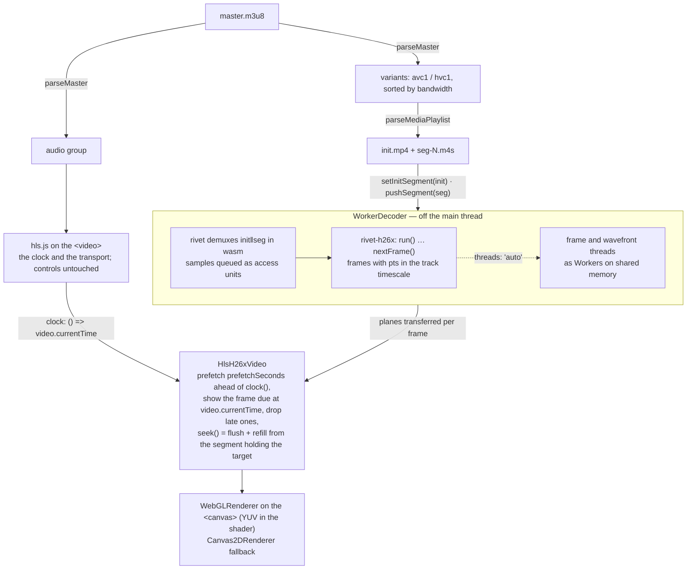
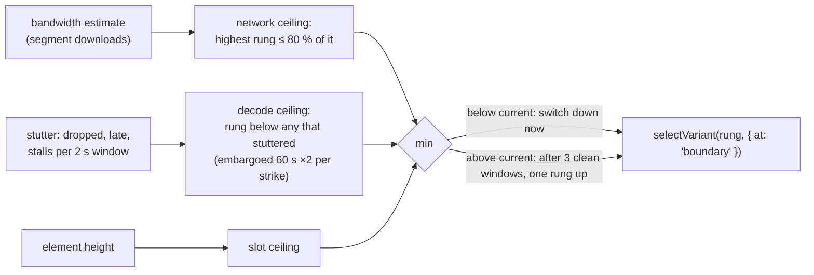

# Integrating the decoder into a video player

What a site that serves H.264 or H.265 needs in order to keep playing on
browsers that cannot decode it — HEVC in Firefox and in browsers without
hardware HEVC, H.264 in builds without a licensed decoder, and profiles the
platform decoder refuses — using this package as the fallback. It is
wasm-av1's integration guide with the codec changed: the shape, the rung
selection, threads and serving are the same. It assumes HLS/CMAF
(fragmented MP4) delivery, which is what most ladders are; the whole-file
paths (`H26xPlayer.load(bytes)`) are covered in the README.

## The decision

```js
import { chooseVariant } from '@safewords/wasm-h26x';

const type = 'video/mp4; codecs="hvc1.1.6.L93.B0"';   // the rendition's own CODECS (avc1… for H.264)
const native = window.MediaSource?.isTypeSupported(type)
  || document.createElement('video').canPlayType(type) !== '';
// Better still: navigator.mediaCapabilities.decodingInfo({ type: 'media-source',
//   video: { contentType: type, width, height, bitrate, framerate } })
//   → { supported, smooth, powerEfficient }: fall back when !supported, consider it when !smooth.
if (!native && chooseVariant()) useWasmFallback();
```

`chooseVariant()` is null on engines older than the baseline build (Safari
< 15, Chrome < 96); there is nothing to do for those. Keep a query-string
override (`?h26x=wasm`) so the fallback can be exercised on any machine.

## The shape: keep the `<video>`, add a `<canvas>`

Keep the `<video>` element as the transport and the clock — play/pause,
seeking, `currentTime`, volume, controls and every listener stay as they are —
and give it only the **audio** rendition (hls.js plays AAC everywhere). A
video-only stream gets a synthesized silent audio track of the same duration
so `currentTime`, `duration` and `ended` stay real. Beside the `<video>`, a
`<canvas>` receives the H.264 or H.265 video rendition, decoded in a Worker and painted
by WebGL whenever `video.currentTime` says a frame is due:

```js
import { HlsH26xVideo, parseMaster } from '@safewords/wasm-h26x';

const master = parseMaster(await (await fetch(masterUrl)).text(), masterUrl);
const audio = master.audio.find((a) => a.isDefault) ?? master.audio[0];
hls.loadSource(audio.url);                       // hls.js on the <video>: the clock

const v = new HlsH26xVideo(canvas, {
  clock: () => video.currentTime,
  worker: true,                                  // decode + demux off the main thread
  threads: 'auto',                               // decoder threads, where the page is isolated (below)
  baseUrl: '/wasm-h26x/',                        // where pkg/ is served
  workerUrl: '/wasm-h26x/js/worker.js',          // where js/ is served (see "Serving")
  fetchText, fetchBytes,                         // add credentials for your media host if needed
  prefetchSeconds: 8,
});
await v.selectVariant(master.variants.find((x) => x.codec === 'hevc' && x.height <= 720));
v.start();
video.addEventListener('seeking', () => v.seek(video.currentTime));
```



Every CMAF segment starts on a random access point, so a seek lands on the
segment holding the target and drops the frames before it (at most one
segment). With open-GOP H.265 (CRA pictures whose RASL pictures refer to
the previous segment) the decoder starts afresh at the segment and skips
those RASL pictures, as a decoder must there: the picture holds for their
length. Ladders encoded with closed GOPs (x265 `--no-open-gop`) do not
have this.

## Which rung: measure both, take the lower

Two things bound the rung, and `HlsH26xVideo` measures both so the player can
take the intersection:

- **Network.** `stats.bandwidth` is a bits/s estimate from the player's own
  segment downloads (hls.js-style: two EWMAs, the estimate is the lower —
  a slow-down is believed at once, a burst is not);
  `variantForBandwidth({ factor: 0.8, maxHeight })` is the highest rung whose
  declared BANDWIDTH fits under it. `stats.bufferAhead` (seconds of segments
  pushed beyond the clock) running low, or `stats.slowFetches` growing
  (a download slower than the segment it carried), means step down now.
- **Decode/render.** Stutter as the viewer sees it, beyond
  `framesDropped`: `stats.lateFrames` (a frame painted more than one frame
  interval after it was due — a hitch), `stats.stalls` / `stallMs` (nothing
  buffered while the clock ran past the last frame: the decoder is not
  keeping up). Any stall, or dropped+late over ~8 % of a 2 s window, is a
  strike against the rung: step down and keep off that height for a while
  (60 s, doubling per strike) so you do not bounce straight back to it.
- **Element size.** Never above the rung that fills the element.

Step **up** only after a few clean windows in a row (under 2 % dropped+late,
no stall, network fine), one rung at a time. Start on a rung the device can
plainly do: [performance.md](performance.md) has what one laptop decodes in
each engine — on one core of an M3 Max, the SIMD build does 1080p at 150
frames per second in Chromium and WebKit for H.264 and about 115 for H.265,
and a tenth of that in Playwright's Firefox, where threads are what make
1080p playable. An old phone is several times slower, so a phone starts at
480p/720p and a laptop wherever the source is.

Make one decoder (one `HlsH26xVideo` or `H26xPlayer`) and reuse it across
videos and seeks rather than one per video: each threads-build instance has
its own shared memory, and in WebKit a page that had made a few dozen of
them could not make more (docs/performance.md, "WebKit and many
instances").



### Switching without a gap

`selectVariant(rung)` while playing switches **at the next segment boundary
the decoder has not reached** — segments already pushed past it are
un-queued and re-fetched from the new rung, the new init segment goes in,
decoding never stops and nothing decoded is lost; the picture changes rung a
segment later with no freeze (all rungs of a ladder start their segments on
keyframes at the same times, which is what makes this exact). It resolves to
`'boundary'`, or `'none'` when the decoder already holds everything to the
end (nothing left to switch), or `'now'` if the playlists are not
segment-aligned and it fell back to the hard switch — `{ at: 'now' }` asks
for that directly: flush and refill from the segment holding the clock,
which shows as a short freeze while it decodes up to the clock again.

## Threads

`threads: 'auto'` (one per logical core, at most 8) spreads the decoding
over the cores: rivet-h26x decodes several pictures at once (frame
threading, both codecs), each waiting only for the rows of its references
its motion vectors reach, and decodes an H.265 picture's wavefront rows,
tiles and slice segments in parallel. What that buys is measured in
[performance.md](performance.md).

With more than one thread the decoder has several pictures in flight
(`threads.clamp(2, 16)` for H.265, by its pool's capacity for H.264), which
changes two things for a caller:

- **Output is a few access units behind input.** `H26xPlayer`,
  `HlsH26xVideo` and `WorkerDecoder` take care of it. If you drive
  `Decoder` yourself: `run()` can return `Run.STARVED` while frames are
  still being decoded on the threads, and `unitsInFlight` says how many
  units have gone in without their frames having come out (an upper bound:
  some may be waiting for later pictures, as B-pictures' references are).
  While it is not 0, call `run()` again a little later (the decode Worker
  does, every 4 ms) and the frames that are done arrive with no new input. At the end of the stream (in
  push mode, after `endOfStream()` as before) `run()` waits for what is in
  flight, and `finished` is true once the last frame is popped.
- **A damaged unit is reported when it goes in** (rivet-h26x checks the
  syntax as it parses), and counted in `stats.decodeErrors`. `flush()`
  drops everything in flight.

With one thread nothing is decoded but what the caller pushes, and a
picture comes out once the next one has begun (or the input ends) and the
reorder buffer lets it. Threads need
`SharedArrayBuffer`, i.e. a
**cross-origin-isolated document**: `Cross-Origin-Opener-Policy: same-origin`
plus a `Cross-Origin-Embedder-Policy`. Which COEP value depends on where your
media comes from:

- `require-corp` isolates every engine (Chrome 83+, Firefox 79+, Safari
  15.2+) but requires every cross-origin subresource loaded without CORS
  (``, `<video poster>`, CSS images…) to carry
  `Cross-Origin-Resource-Policy: cross-origin` (or `same-site`). If media
  comes from a CDN/host you control, add that header there; presigned URLs
  straight from an object store cannot carry it, and any such `` breaks.
- `credentialless` (Chrome 96+, Firefox 119+; not Safari) instead sends
  no-cors cross-origin loads without credentials and needs no CORP header —
  the safe choice when media is on hosts you cannot add headers to. Safari
  ignores it and stays un-isolated: nothing breaks, the fallback is
  single-threaded there.

Without isolation nothing breaks either: `detectThreads()` is false, the
single-thread build loads, `stats.threads` is 1. Note `COOP: same-origin`
severs `window.opener` for cross-origin popups — check OAuth-in-a-popup flows.
The decoder must be in a Worker for threads (`worker: true`; the player
forces this).

## Serving

`pkg/` is a few MB per variant (the sizes are in the README; about a third
of that gzipped); one variant is fetched, lazily, only after the decision
above says so. Serve `pkg/` as static files from your own origin (no CORS
on the `.wasm`, and a Worker inherits the page's isolation), under a path
that carries the package version so it caches immutably, and pass
`baseUrl`. The `.wasm` must be files, not bundled. For the Worker, either
let the bundler resolve `new Worker(new URL('./worker.js',
import.meta.url))` or — more predictably — serve `js/` statically too and
pass `workerUrl` (its imports are relative). With Vite, a small plugin that
copies `node_modules/@safewords/wasm-h26x/{pkg,js}` into
`dist/wasm-h26x/<version>/` and defines the base URL is all it takes.

## Not in scope of the fallback

Captions, DRM, and audio decoding (the browser does AAC natively everywhere).
